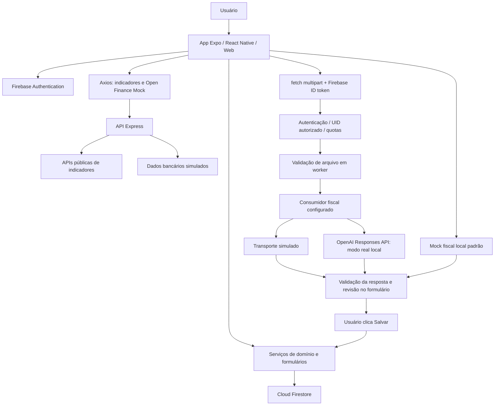

# FinanceIQ

O **FinanceIQ** é um aplicativo de controle financeiro pessoal desenvolvido como Trabalho de Conclusão de Curso (TCC) em Ciência da Computação. Reúne cadastro e autenticação, perfil financeiro, receitas e despesas por mês, categorias e limites, Dashboard, metas, relatórios com exportação em PDF, orientações educativas por regras, indicadores econômicos e uma simulação acadêmica de Open Finance. A importação inteligente de notas fiscais com OpenAI complementa o cadastro manual de lançamentos.

O aplicativo usa React Native, Expo e TypeScript. Firebase Authentication identifica as contas e Cloud Firestore persiste os dados financeiros. A API própria, em Node.js, Express e TypeScript, atende indicadores, Open Finance Mock e análise fiscal. A análise fiscal real está implementada para **desenvolvimento local supervisionado**, com revisão humana e salvamento manual; não constitui infraestrutura de produção pronta.

> **Estado documentado:** auditoria de 07/11/2026 sobre o working tree da branch `docs/atualizacao-readme-tcc`, HEAD `c964968f39128a3119967509bc833408e3d23703` (14/10/2026), incluindo alterações funcionais locais preexistentes ainda sem commit. Nesta auditoria, somente este README foi editado. Os testes executados usam dados sintéticos, Firebase substituído e clientes OpenAI falsos. As evidências reais de PDF e câmera foram informadas pelo responsável, sem repetição nesta tarefa.

## Sumário

- [Objetivos e escopo](#objetivos-e-escopo)
- [Stack tecnológica](#stack-tecnológica)
- [Arquitetura e comunicação](#arquitetura-e-comunicação)
- [Estrutura do projeto](#estrutura-do-projeto)
- [Funcionalidades do aplicativo](#funcionalidades-do-aplicativo)
- [Firebase e modelo de dados](#firebase-e-modelo-de-dados)
- [Integrações externas e API](#integrações-externas-e-api)
- [Importação inteligente de notas fiscais](#importação-inteligente-de-notas-fiscais)
- [Execução local](#execução-local)
- [Testes e qualidade](#testes-e-qualidade)
- [Segurança, privacidade e limitações](#segurança-privacidade-e-limitações)
- [Estado atual e preservação histórica](#estado-atual-e-preservação-histórica)
- [Informações para o artigo científico](#informações-para-o-artigo-científico)
- [Autores](#autores)
- [Guia de continuidade do projeto](#guia-de-continuidade-do-projeto)

## Objetivos e escopo

O problema abordado é a organização de informações financeiras pessoais e sua transformação em uma visão compreensível de entradas, gastos, planejamento e objetivos. O objetivo geral do sistema é apoiar esse acompanhamento por meio de uma aplicação com dados associados à conta do usuário.

Os objetivos funcionais implementados são registrar e consultar movimentações, organizar despesas por categorias e competência mensal, acompanhar saldo e limites, produzir relatórios, acompanhar metas, oferecer mensagens educativas e auxiliar o preenchimento de lançamentos a partir de documentos fiscais. O usuário permanece responsável por revisar e confirmar os registros.

| Recurso | Implementação e alcance |
| --- | --- |
| Assistente FinanceIQ, sugestões e educação financeira | Regras locais, palavras-chave e projeções matemáticas; não dependem da OpenAI. |
| Open Finance Mock | Instituições, contas, saldos, transações e permissões simulados; não há conexão bancária real. A sincronização confirmada grava dados simulados no Firestore da conta utilizada. |
| Importação fiscal | Mock local por padrão; backend simulado ou análise real pela OpenAI em desenvolvimento, conforme configuração explícita. Não salva lançamentos automaticamente. |

Implementação, validação automatizada e validação manual são evidências distintas. Este README não atribui certificação fiscal, avaliação estatística de precisão ou prontidão para produção ao sistema.

## Stack tecnológica

As versões abaixo são declarações dos manifests auditados; os dois `package-lock.json` registram as resoluções utilizadas na instalação.

| Camada | Tecnologias e referência |
| --- | --- |
| Aplicativo | Expo `~54.0.33`, React `19.1.0`, React Native `0.81.5`, React Native Web `^0.21.0`, TypeScript `~5.9.2`; [package.json](package.json). |
| Navegação e interface | React Navigation 7, Expo Vector Icons, Safe Area Context e Gesture Handler. |
| Identidade e dados | Firebase cliente `^12.13.0`, Authentication e Cloud Firestore; AsyncStorage `2.2.0` para onboarding. |
| Comunicação | Axios no aplicativo e nos indicadores do backend; `fetch`/`FormData` no upload fiscal. |
| Arquivos e câmera | Expo Document Picker `~14.0.8`, Image Picker `~17.0.11`, File System `~19.0.23` e adaptadores Web próprios. |
| PDF dos relatórios | Expo Print `~15.0.8` e `expo-file-system/legacy`. |
| Backend | Express `^5.2.1`, TypeScript `^5.9.3`, CORS, dotenv e ts-node-dev; [financeiq-api/package.json](financeiq-api/package.json). |
| Análise fiscal no servidor | Firebase Admin `14.5.0`, SDK OpenAI `7.33.0`, Busboy `3.2.3`, Sharp `0.35.5` e PDF.js `6.4.299`. |
| Testes | Runner nativo `node:test`, assert, transpilação TypeScript/VM, ts-node e HTTP em loopback. |

O ambiente desta auditoria utilizou **Node.js 24.14.1 e npm 11.11.0**. Os pacotes instalados Firebase Admin/OpenAI declaram Node 22 ou superior; PDF.js declara `>=22.13.0 || >=24`. O projeto não fixa uma versão por campo `engines`. A dependência/plugin `expo-sqlite` permanece, mas a persistência financeira ativa é Firestore.

## Arquitetura e comunicação

O frontend separa telas, componentes, serviços de domínio e acesso ao Firestore. Usa hooks React para estado local e efeitos de foco; refs também controlam operações em andamento e resultados obsoletos. Não foi encontrado gerenciador global como Redux.

A entrada efetiva é [index.ts](index.ts) → [App.tsx](App.tsx) → [AppNavigator.tsx](src/AppNavigator.tsx) → abas de [routes.tsx](src/routes.tsx). `src/pages/Index.tsx` é um arquivo adicional, não a entrada registrada no Expo.



O aplicativo acessa Authentication e Firestore diretamente pelo SDK Firebase. As operações financeiras comuns não passam pelo Express. Consultas usam o UID da sessão; essa separação lógica não substitui regras de segurança do Firestore.

No backend, [app.ts](financeiq-api/src/app.ts) registra as rotas e permite injeção de dependências para testes; [server.ts](financeiq-api/src/server.ts) inicia a API convencional. A entrada operacional [receiptLocalServer.ts](financeiq-api/src/receiptLocalServer.ts) carrega configuração externa e inicia o perfil fiscal em loopback. O piloto histórico possui entrada e trava próprias.

O backend consulta serviços públicos para indicadores, gera dados bancários fictícios e, no modo fiscal real, verifica o token com Firebase Admin e envia o documento à OpenAI. A rota fiscal não grava lançamentos nem consulta categorias no Firestore. Os campos validados voltam ao formulário; o botão Salvar aciona o serviço de transações existente.

## Estrutura do projeto

A árvore destaca caminhos reais e agrupa arquivos sem reproduzir dependências ou artefatos gerados.

```text
Projeto_Mobile-FinanceIQ/
├── App.tsx / index.ts              # Entrada e contêiner de navegação
├── firebaseConfig.ts              # Inicialização e exports app/auth/db
├── app.json                       # Expo e permissões de câmera
├── package.json / package-lock.json / tsconfig.json
├── .env.example                   # Somente configuração pública do cliente
├── assets/
├── src/
│   ├── AppNavigator.tsx / routes.tsx
│   ├── pages/                     # Login.tsx e Index.tsx
│   ├── screens/
│   │   ├── Onboarding.tsx / ConfiguracaoPerfil.tsx
│   │   ├── Dashboard.tsx / Lancamentos.tsx / Categorias.tsx
│   │   ├── Relatorios.tsx / MetasFinanceiras.tsx / Perfil.tsx
│   │   └── OpenFinance.tsx / OpenFinanceBankDetails.tsx
│   ├── components/ReceiptImportSection.tsx
│   ├── constants/                 # Categorias, palavras-chave, regras e mock fiscal
│   ├── database/
│   │   ├── transactionService.ts / categoryService.ts / goalService.ts
│   │   ├── userProfileService.ts / openFinanceConsentService.ts
│   │   └── initializeDatabase.ts  # Legado SQLite sem chamada no fluxo ativo
│   ├── services/
│   │   ├── api.ts / economicIndicatorsService.ts / openFinanceService.ts
│   │   ├── periodService.ts / reportAnalysisService.ts / reportPdfService.ts
│   │   ├── categoryAnalysisService.ts / categorySuggestionService.ts
│   │   ├── financialEducationService.ts / goalAnalysisService.ts
│   │   ├── receiptAcquisitionService.ts / receiptAcquisitionService.web.ts
│   │   ├── receiptDocumentService.ts / receiptAnalysisService.ts
│   │   ├── receiptMockService.ts / receiptBackendService.ts
│   │   ├── receiptMultipartService.ts / receiptMultipartService.web.ts
│   │   ├── receiptBackendResponseService.ts / receiptFormService.ts
│   │   └── userActionService.ts   # Alteração local preexistente
│   └── types/receipt.ts
├── financeiq-api/
│   ├── package.json / package-lock.json / tsconfig.json
│   ├── .env.example / receipt-local.env.example
│   ├── src/
│   │   ├── app.ts / server.ts
│   │   ├── receiptLocal.ts / receiptLocalServer.ts
│   │   ├── receiptPilot.ts / receiptPilotServer.ts
│   │   ├── routes/               # indicatorsRoutes, openFinanceRoutes, receiptRoutes
│   │   ├── controllers/          # indicatorsController, openFinanceController, receiptController
│   │   ├── middleware/           # receiptAuth, receiptUpload, receiptAnalysis
│   │   ├── schemas/              # receiptExtractionSchema.ts e receiptPolicy.md
│   │   ├── types/                # Contratos de autenticação, extração e OpenAI
│   │   └── services/             # Firebase Admin, indicadores, mock bancário e serviços fiscais
│   ├── workers/receiptDocumentWorker.cjs
│   └── docs/                     # Contratos e registros das etapas fiscais
├── scripts/receipts-local.cjs     # Launcher backend/Web/Android
├── tests/
│   ├── *.test.cjs
│   ├── fixtures/receiptExtraction.json
│   └── helpers/                  # Runtime de hooks, fixtures e guardas de I/O
└── docs/                         # Operação local e integração fiscal no aplicativo
```

`node_modules/`, `dist/`, `.expo/` e builds nativos gerados são ignorados pelo Git. Artefatos locais não demonstram qual revisão foi validada. Configurações privadas e documentos fiscais reais não integram esta árvore.

## Funcionalidades do aplicativo

### Autenticação, onboarding e sessão

[Login.tsx](src/pages/Login.tsx) implementa cadastro com nome, e-mail, senha e confirmação de senha, e login por e-mail/senha. Usa Firebase Authentication, incluindo atualização do nome de exibição após criar a conta. Há validações de campos e tratamento de erros de autenticação. **Não foi encontrado fluxo de recuperação de senha** nem uso de `sendPasswordResetEmail`.

[Onboarding.tsx](src/screens/Onboarding.tsx) registra conclusão ou salto da introdução na chave local `hasSeenOnboarding` do AsyncStorage. Essa informação pertence à instalação/dispositivo, não ao perfil em nuvem. `AppNavigator` combina onboarding com `onAuthStateChanged`.

```text
Primeiro acesso sem sessão → Onboarding → Login/Cadastro
Cadastro → Configuração de Perfil → Início
Login de conta existente → Início
Perfil → Sair da Conta → confirmação → signOut → Login
Abas: Início | Lançamentos | Categorias | Relatórios | Perfil
Dashboard → Metas em destaque → Metas Financeiras
Perfil → Open Finance → Detalhes da Conta
```

Os ajustes locais preexistentes em `AppNavigator`, `Login`, `Perfil` e `userActionService` coordenam o término do cadastro antes de montar rotas autenticadas, retiram rotas protegidas no logout e usam confirmação Web (`window.confirm`) ou diálogos nativos. Evitam repetição de logout e interferência de leitura atrasada do onboarding. Estão no working tree, ainda sem commit; esta tarefa documental não os implementou.

[App.tsx](App.tsx) contém lógica de encerramento após **cinco minutos de inatividade**, renovada por interações capturadas e mudanças de navegação. É controle do cliente, não política de expiração imposta pelo servidor, e não recebeu validação manual multiplataforma nesta auditoria. O arquivo também trata o botão voltar Android: navega para Início e, nessa tela, solicita confirmação para sair.

### Perfil financeiro e salário

[ConfiguracaoPerfil.tsx](src/screens/ConfiguracaoPerfil.tsx) recebe salário mensal e perfil **Conservador, Moderado ou Agressivo**. Exige preenchimento, sessão e salário numérico não negativo. Salva `risk_profile` em `users/{uid}`, garante os fixos do mês e atualiza **Salário Mensal** como entrada fixa. O salário não é campo separado do perfil.

[Perfil.tsx](src/screens/Perfil.tsx) mostra nome/e-mail, perfil de risco e salário do mês, e oferece Open Finance e logout. Dados Pessoais, Salário Mensal e Perfil de Risco não possuem handlers de edição nessa tela. Os switches de modo escuro/notificações têm valores definidos na interface, sem persistência ou serviços de tema/push/e-mail implementados.

O salário inicial não é replicado automaticamente para todos os meses: os fixos de cada novo período começam em zero. Seu valor continua editável pelo lançamento fixo correspondente.

### Lançamentos fixos e personalizados

[Lancamentos.tsx](src/screens/Lancamentos.tsx) e [transactionService.ts](src/database/transactionService.ts) trabalham com valores positivos em reais e tipo `income` (entrada) ou `outcome` (saída). O sinal econômico é determinado pelo tipo.

Para cada usuário e mês, o serviço garante quatro fixos inicialmente em zero: **Salário Mensal** (entrada), **Moradia**, **Transporte** e **Alimentação** (saídas). Não são agendamentos bancários nem cópias de valores anteriores. A identificação usa `is_fixed` e os quatro nomes legados.

Na interface, fixos não exibem exclusão. A edição permite **Adicionar** ao valor existente ou **Substituir** o total: R$ 30,00 mais R$ 20,00 resulta em R$ 50,00; substituir resulta em R$ 20,00. A proteção de exclusão pertence à interface: `transactionService.remove(id)` não verifica `is_fixed` por conta própria.

O fluxo **+ → Novo Lançamento → descrição, valor, tipo e categoria → Salvar** cria um personalizado. Exige descrição no cadastro, valor maior que zero, usuário autenticado e categoria existente, ativa e compatível com o tipo. Há máscara monetária brasileira e proteção contra repetição durante o salvamento.

A edição de personalizados exposta pela tela altera **valor e categoria**. Descrição e tipo não ficam disponíveis para edição, nem há seletor de data/competência nesse formulário. O serviço aceita outros campos, mas isso não significa que a tela disponibilize essas operações. Corrige-se assim o README antigo, que atribuía à interface edição de descrição e período.

Personalizados podem ser excluídos após confirmação. Os ajustes locais preexistentes tornam essa confirmação compatível com Web, bloqueiam repetições durante a exclusão e evitam aplicar recarga antiga à sessão atual. A importação fiscal aparece somente para **novos lançamentos**.

### Controle mensal, datas e consultas

[periodService.ts](src/services/periodService.ts) representa competências em `period_month` (`AAAA-MM`), calcula início/fim do mês, rótulos e deslocamentos. `date` representa a data associada ao lançamento, sem substituir a competência explícita.

`transactionService.listAll(uid)` garante fixos e retorna **o mês atual**. `listByPeriod(uid, periodo)` consulta documentos do usuário ordenados por `date` e filtra o mês **em memória**. Na ausência de competência em dados antigos, deriva por `original_date`, depois `date`, ou usa o mês atual se não houver data aproveitável. Fixos usam o primeiro dia do período; novos manuais usam a data corrente quando nenhuma data é fornecida ao serviço.

O seletor mensal está em **Relatórios**, com retorno ao mês atual e sem avanço além dele. Dashboard, Categorias e Lançamentos concentram-se no mês corrente. Não há filtro arbitrário por intervalo de dias na interface auditada.

### Categorias, limites e sugestões

[defaultCategories.ts](src/constants/defaultCategories.ts) define os padrões por usuário:

| Categoria | Tipo | Limite mensal inicial em reais |
| --- | --- | ---: |
| Moradia | Saída | 2.000,00 |
| Alimentação | Saída | 1.200,00 |
| Transporte | Saída | 500,00 |
| Saúde | Saída | 400,00 |
| Lazer | Saída | 500,00 |
| Educação | Saída | 400,00 |
| Compras | Saída | 600,00 |
| Outros | Saída | 300,00 |
| Receita | Entrada | 0,00 |

São constantes de inicialização ajustáveis, não recomendações calculadas a partir da renda. `categoryService.listAll` pode criar padrões ausentes antes de consultar as categorias ativas.

[Categorias.tsx](src/screens/Categorias.tsx) mostra análise das categorias **de saída** ativas. Permite criar personalizada com **nome e limite mensal**, editar limite, consultar detalhes/movimentações e excluir personalizadas. Na criação pela tela, ícone `tag`, cor `#1B365D` e tipo `outcome` são definidos pelo código. O modelo/serviço aceita ícone, cor e tipo, mas a interface não oferece esses seletores. Padrões não podem ser excluídos pela tela. Excluir categoria personalizada não apaga transações, que guardam o nome como texto.

O cadastro verifica duplicidade por usuário normalizando caixa e espaços nas extremidades. A associação das análises usa nomes normalizados e alguns aliases legados, como Geral/Outros. `Transaction` não possui relacionamento por ID de categoria.

[categoryAnalysisService.ts](src/services/categoryAnalysisService.ts) calcula gasto, restante, percentual bruto, barra limitada a 100%, transações vinculadas e mensagens. [financialRules.ts](src/constants/financialRules.ts) estabelece:

| Condição | Status |
| --- | --- |
| Limite menor ou igual a zero | `sem_limite` |
| Uso abaixo de 60% | `controlado` |
| Uso de 60% até menos de 85% | `atencao` |
| Uso de 85% até 100%, inclusive | `proximo_limite` |
| Uso acima de 100% | `excedido` |

A igualdade a 100% é limite atingido; o código considera excedido somente **acima de 100%**. A análise educativa usa tolerância de R$ 0,01 para equilíbrio.

[categorySuggestionService.ts](src/services/categorySuggestionService.ts) e [categoryKeywords.ts](src/constants/categoryKeywords.ts) sugerem somente categorias existentes, ativas e compatíveis com o tipo. Normalizam acentos, caixa e pontuação, comparam palavras completas/expressões e preservam ambiguidades. Protegem contra falsos positivos como interpretar `99,90` como transporte por aplicativo.

Exemplos: Netflix → Lazer; Uber → Transporte; iFood → Alimentação; supermercado e certas compras online → Compras, com confirmação conforme a confiança. Evidências conflitantes não escolhem categoria por ordem de cadastro. **Categorias personalizadas exigem confirmação, mesmo com nome completo; fragmentos de palavras não bastam.** Isso atualiza a descrição histórica de seleção automática por nome completo de personalizada. A escolha manual válida tem prioridade no formulário.

### Educação financeira e projeções

[financialEducationService.ts](src/services/financialEducationService.ts) gera mensagens para economia, excesso, equilíbrio e ausência de limite. Projeta a diferença mensal em **6, 12 e 24 meses** por multiplicação simples. Estar abaixo do limite no mês em andamento não significa economia final garantida. São orientações educativas por regras, sem IA generativa ou previsão de rentabilidade.

### Dashboard e panorama do mês

[Dashboard.tsx](src/screens/Dashboard.tsx) carrega transações do mês, categorias e metas, consulta indicadores separadamente e atualiza ao ganhar foco. Mostra saudação, entradas, saídas, saldo, Panorama do mês, Metas em destaque e até **oito movimentações recentes**.

```text
Saldo disponível do mês = entradas do mês − saídas do mês
```

O saldo não é consolidado bancário nem incorpora automaticamente meses anteriores. Somente transações persistidas no período entram no cálculo. Saldos simulados autorizados não são somados diretamente à Dashboard.

O **Panorama do mês** reutiliza `reportAnalysisService`: gasto acumulado, soma dos limites de saída, restante/excesso, percentual usado, maior categoria e status visual. Inclui Dentro do planejado, Mês em atenção, Perto do limite, Acima do planejado e Sem despesas. O card de metas mostra até duas em destaque e abre a tela completa, sem criar outra aba.

### Metas financeiras e Assistente FinanceIQ

[MetasFinanceiras.tsx](src/screens/MetasFinanceiras.tsx), [goalService.ts](src/database/goalService.ts) e [goalAnalysisService.ts](src/services/goalAnalysisService.ts) implementam criação, edição, exclusão, adição/substituição de acumulado, conclusão e reabertura. A meta contém título, descrição, alvo, acumulado, aporte mensal planejado, prazo opcional, ícone, cor e conclusão. A tela exige título e alvo positivo e interpreta prazo por mês/ano.

O assistente calcula percentual, restante, meses estimados (`ceil(restante/aporte)` quando há aporte), relação com prazo e prioridade de destaque. Estados: **Concluída, Quase lá, Em andamento, Prazo apertado, Atrasada e Sem aporte**. Quase lá considera pelo menos 80% de progresso, respeitadas as condições anteriores da análise. Aportes são progresso informado manualmente: não movimentam contas nem criam transações automaticamente.

Concluir define acumulado igual ao alvo. Reabrir grava `is_completed=false`, mas a listagem/análise também considera concluída uma meta cujo acumulado atingiu o alvo. Portanto, reabrir sem reduzir o valor pode continuar mostrando conclusão. Essa limitação foi identificada no código e não corrigida nesta tarefa.

### Relatórios mensais e exportação em PDF

[Relatorios.tsx](src/screens/Relatorios.tsx) consulta meses e usa [reportAnalysisService.ts](src/services/reportAnalysisService.ts) para entradas, saídas, saldo, limites planejados, restante, contagens, maior categoria, distribuição de gastos e proporção entradas/saídas. Destaca até cinco categorias. Mensagens distinguem mês em andamento e período encerrado. O serviço de análise recebe transações já filtradas pelo chamador.

Os relatórios usam limites **atuais** das categorias, sem snapshot mensal: alterar um limite pode mudar a interpretação de um mês antigo.

[reportPdfService.ts](src/services/reportPdfService.ts) gera HTML com escape de conteúdo e usa Expo Print. O PDF contém identificação do FinanceIQ, período, resumo, entradas/saídas, categorias, insights e detalhes. No Android solicita pasta pelo **Storage Access Framework** e grava base64; recusar retorna cancelamento. Outras plataformas seguem o diretório de documentos quando suportado. Não existe download Web específico nem comprovação de exportação Web/iOS nesta auditoria. Exportar relatório é um fluxo distinto de importar nota fiscal.

## Firebase e modelo de dados

[firebaseConfig.ts](firebaseConfig.ts) inicializa Firebase com `getAuth`/`getFirestore` e exporta `app`, `auth` e `db`. A estrutura foi verificada sem reproduzir valores de configuração. Cadastro, nome e credenciais pertencem ao Authentication; não existem documentos de senha no Firestore.

| Coleção/documento | Identificação e campos principais | Serviço em `src/database` |
| --- | --- | --- |
| `users/{uid}` | ID igual ao UID; `risk_profile`; salvo com merge. | [userProfileService.ts](src/database/userProfileService.ts) |
| `transactions/{id}` | `user_id`, `description`, `amount`, `type`, `category`, `is_fixed`, `source`, `date`, `period_month`, `created_at`, `updated_at`. | [transactionService.ts](src/database/transactionService.ts) |
| `categories/{id}` | `user_id`, `name`, `icon`, `color`, `monthly_limit`, `type`, `description`, `is_default`, `is_active`, timestamps. | [categoryService.ts](src/database/categoryService.ts) |
| `goals/{id}` | `user_id`, `title`, `description`, `target_amount`, `current_amount`, `monthly_contribution`, `deadline`, `icon`, `color`, `is_completed`, timestamps. | [goalService.ts](src/database/goalService.ts) |
| `open_finance_consents/{uid}_{bankId}` | `user_id`, `bank_id`, `bank_name`, `account_id`, `account_type`, `connected`, `permissions`, `last_sync`, timestamps. | [openFinanceConsentService.ts](src/database/openFinanceConsentService.ts) |

Transações importadas do mock também guardam `external_id`, `bank_name`, `account_id`, `original_date` e `imported_at`, com `source='open_finance_mock'`. Novos registros manuais, inclusive preenchidos por nota fiscal e confirmados pelo usuário, seguem `source='manual'`; não há origem fiscal adicional persistida.

Regras relevantes:

- Valores persistidos são `number` em **reais**. A extração fiscal intermediária usa **centavos inteiros**, convertidos após validação. Máscaras monetárias são apresentação.
- `date` e prazos usam Timestamp nos serviços; criação/atualização/importação usam `serverTimestamp` nos respectivos fluxos. `period_month` é string; datas originais importadas podem ser `AAAA-MM-DD`.
- Consultas filtram por `user_id`; perfil usa ID igual ao UID. Vários métodos de atualização/exclusão recebem apenas ID de documento. Seus handlers não demonstram autorização no servidor Firestore.
- `transactionService.listAll` e `categoryService.listAll` **podem escrever**, criando padrões ausentes. Abrir telas não é necessariamente somente leitura. Não usar esses serviços com conta real para uma auditoria sem gravações.
- Não há recorrência automática de valores, movimentação de dinheiro pelas metas ou persistência financeira no backend fiscal.
- A deduplicação consulta `user_id + external_id` antes de inserir. É controle sequencial da aplicação, sem restrição única/transação atômica que garanta unicidade sob importações concorrentes.
- Excluir categoria não apaga transações; o histórico conserva o nome textual, podendo perder limite/metadados da categoria removida.

A consulta por usuário ordenada por `date desc` pode exigir índice composto `user_id` crescente + `date` decrescente. Não foram encontrados arquivos versionados de regras/índices do Firestore. **Regras implantadas, índices efetivos e isolamento entre contas no servidor não foram auditados.** Este README não recomenda regras permissivas como configuração de desenvolvimento.

[initializeDatabase.ts](src/database/initializeDatabase.ts) contém tabelas SQLite legadas `transactions` e `user_profile`, sem chamada encontrada no fluxo ativo. AsyncStorage controla onboarding, não é a persistência financeira principal. Não há camada própria de sincronização offline demonstrada por esses arquivos.

## Integrações externas e API

### Endpoints e comunicação HTTP

[api.ts](src/services/api.ts) centraliza Axios com `EXPO_PUBLIC_API_URL` e timeout de 10 s. Sem variável usa o placeholder `http://IP_DO_COMPUTADOR:3000`, que precisa ser configurado. O serviço fiscal reaproveita a base, mas envia com `fetch`, timeout/cancelamento próprios, sem interceptor global de token.

| Método e rota | Uso | Autenticação na API auditada |
| --- | --- | --- |
| `GET /health` | Disponibilidade básica do processo, sem testar provedores. | Sem Bearer. |
| `GET /indicators/selic`, `/ipca`, `/dollar`, `/summary` | Indicadores e resumo. | Sem Bearer. |
| `GET /open-finance/accounts/:userId` | Contas fictícias. | Sem Bearer; UID é parâmetro do mock. |
| `GET /open-finance/balances/:userId` | Saldos simulados. | Sem Bearer. |
| `GET /open-finance/transactions/:userId` | Histórico simulado. | Sem Bearer. |
| `POST /open-finance/sync/:userId` | Retorna dados para importação pelo cliente. | Sem Bearer; backend não grava Firestore. |
| `POST /receipts/analyze` | Limites, validação e análise configurada. | Firebase ID token e UID autorizado obrigatórios. |

A proteção fiscal não é global: não descrever toda a API como autenticada. Rotas e controllers estão em [financeiq-api/src/routes](financeiq-api/src/routes) e [financeiq-api/src/controllers](financeiq-api/src/controllers).

### Indicadores econômicos

[economicIndicatorsService.ts](src/services/economicIndicatorsService.ts) consulta Selic, IPCA e Dólar Comercial. Apesar do nome legado, [indicatorsMockService.ts](financeiq-api/src/services/indicatorsMockService.ts) tenta obter taxas em `https://brasilapi.com.br/api/taxas/v1` e cotação em `https://open.er-api.com/v6/latest/USD`, campo BRL.

Falha externa ou indicador ausente produz **fallback fixo** com `source='Fallback FinanceIQ'`: Selic 10,5; IPCA 4,62; dólar 5,25. São constantes do código, não cotações atuais verificadas. `date` é a data de consulta gerada pelo backend, inclusive no fallback, não necessariamente publicação da fonte. Dólar Comercial é o rótulo do app; não foi comprovada equivalência com taxa oficial específica, como PTAX.

Se a API FinanceIQ estiver inacessível, a Dashboard exibe indicadores ausentes. Nenhum provedor externo foi consultado nesta auditoria. A manutenção deve distinguir fonte consultada, fallback e atualização efetiva.

### Open Finance Mock

[OpenFinance.tsx](src/screens/OpenFinance.tsx) e [OpenFinanceBankDetails.tsx](src/screens/OpenFinanceBankDetails.tsx) simulam Nubank, Itaú, Bradesco e C6 Bank. O backend usa [openFinanceMockService.ts](financeiq-api/src/services/openFinanceMockService.ts), com transações/datas predefinidas. Não solicita senha bancária nem usa APIs bancárias reais ou consentimento regulatório.

O usuário autoriza instituição, concede permissões simuladas de **saldo**, **histórico** e **dados cadastrais**, e abre detalhes da conta. Consentimentos são persistidos por instituição; a tela aplica a seleção de permissões aos bancos conectados e recupera a configuração de um consentimento conectado ao carregar. Não é infraestrutura de autorização bancária no servidor.

Saldo por banco = entradas simuladas − saídas simuladas. **Saldo autorizado simulado** soma bancos conectados, sem alterar diretamente a Dashboard. A importação exige instituição, permissão de histórico e confirmação; o cliente chama `/sync`, filtra contas conectadas e grava Firestore, contando importados/ignorados. As datas originais permanecem: dados de maio/2026 pertencem àquele mês e podem aparecer no relatório de maio sem alterar o saldo atual.

A desconexão remove consentimento e pretende remover importados. **Inconsistência comprovada por inspeção:** a tela passa `selectedBank.accountId` para `removeOpenFinanceTransactionsByBank`, mas o serviço compara com `bank_name`, salvo com o nome do banco. Os registros normais podem permanecer após desconectar. O fluxo histórico foi preservado na documentação com essa limitação, sem afirmar remoção integral validada. Não houve teste contra dados reais ou correção nesta tarefa.

## Importação inteligente de notas fiscais

### Fluxo e modos

```text
Lançamentos → + / Novo Lançamento → Importar nota fiscal
→ Tirar foto ou Escolher arquivo → análise → conferência
→ completar descrição/tipo/categoria/valor → Salvar
→ transactionService.add → Firestore → listagem
```

Selecionar inicia a análise no modo ativo. **Salvar** continua sendo a confirmação de persistência. O aviso anterior à seleção informa quando haverá envio ao servidor FinanceIQ e à OpenAI.

| Frontend | Comportamento |
| --- | --- |
| Variável ausente ou `EXPO_PUBLIC_RECEIPT_ANALYSIS_MODE=mock` | Dados demonstrativos locais; não interpreta conteúdo fiscal nem envia arquivo à API/OpenAI. Ainda pode abrir câmera/seletor. |
| `backend-simulated` em desenvolvimento | Upload autenticado; resposta demonstrativa, sem reconhecimento financeiro. Exige `isSimulated=true`. |
| `backend-real` em desenvolvimento | Upload autenticado; exige `isSimulated=false` e backend explicitamente habilitado. |
| Modo desconhecido ou backend em build de produção | Análise bloqueada, sem fallback silencioso; cadastro manual disponível. |

No servidor, `RECEIPT_ANALYSIS_MODE` distingue `disabled`, `simulated` e `real`. Disabled pode retornar 501 após autenticação/upload válidos; não significa remoção da integração. Configuração do cliente não habilita servidor nem rearma piloto. Não há fallback de modelo ou retry automático.

### Captura, formatos e validação

[ReceiptImportSection.tsx](src/components/ReceiptImportSection.tsx) coordena aquisição, progresso, mensagens, cancelamento e aplicação. [receiptAcquisitionService.ts](src/services/receiptAcquisitionService.ts) usa Expo Image Picker para câmera traseira, com permissão runtime e mensagens distintas para recusa/bloqueio. A captura pede imagem sem edição, base64 ou EXIF na resposta do picker. A seleção usa Expo Document Picker, um arquivo, sem cópia deliberada para cache.

O adaptador `.web.ts` usa input de arquivo e URL `blob:`. `capture=environment` é preferência do navegador, que pode abrir seletor em vez de câmera. A interface permite cancelamento explícito quando o navegador não detecta fechamento. Metadados devem ter extensão/MIME compatíveis, tamanho conhecido/positivo e até **10 MiB (10.485.760 bytes)**.

| Regra no backend | Implementação |
| --- | --- |
| Upload | Campo multipart único `document`; JPG/JPEG, PNG ou PDF. Rejeita URLs/campos textuais extras. |
| Tamanho | Até 10 MiB, limite adicional de envelope e contagem durante streaming. |
| Imagem | Assinatura e extensão/MIME, decodificação Sharp, largura/altura padrão até 10.000 e até 20 milhões de pixels; rejeita multipágina/corrompida. |
| PDF | Assinatura/estrutura por PDF.js, 1 a 3 páginas; rejeita protegido, truncado e avisos de reparo. |
| Isolamento | Worker descartável com heap V8 limitado a 128 MiB e ambiente reduzido, sem chave/token/ADC. Não é sandbox completo do sistema operacional. |
| Prazos | Upload 20 s; validação 8 s por padrão. |

O original escolhido não é apagado. URLs Web próprias são revogadas ao liberar documento. Só fotos temporárias criadas pela câmera e reconhecidas no cache são elegíveis à limpeza pelo app; uma falha pode deixar arquivo em cache.

### Autenticação, autorização e quotas

[receiptBackendService.ts](src/services/receiptBackendService.ts) usa `auth.currentUser.getIdToken()` e `Authorization: Bearer ...`. Multipart nativo usa descritor de arquivo; Web lê o `blob:` local e compõe FormData. O runtime define boundary, sem UID autorizador no corpo, cookies ou `Content-Type` multipart manual.

[receiptAuth.ts](financeiq-api/src/middleware/receiptAuth.ts) aceita um único Bearer e autoriza o UID verificado. [firebaseAdminService.ts](financeiq-api/src/services/firebaseAdminService.ts) usa ADC e `verifyIdToken(token, true)`, incluindo revogação, e bloqueia emulador Firebase. Ausência de configuração, wildcard na allowlist ou UID não autorizado não libera acesso. Essa cadeia executa antes de ler o upload.

O perfil operacional autoriza **um UID** (`RECEIPT_LOCAL_UID`), com padrões de **2 uploads/minuto, 5/dia UTC, concorrência global 1 e por UID 1**. Configuração local permite 1–5/minuto e 1–10/dia. Upload inválido após adquirir reserva também consome quota em memória.

Antes do provedor, [receiptLocalAttempts.ts](financeiq-api/src/services/receiptLocalAttempts.ts) consome atomicamente um slot em `operational-attempts` ao lado da configuração externa. Arquivos `local-AAAA-MM-DD-N.attempt` guardam apenas uma versão fixa, sem UID/documento/segredo. Erro/timeout/cancelamento após consumo não devolve slot; reiniciar conserva o limite diário de tentativas ao provedor. Janelas em memória e concorrência não são distribuídas. Não apagar/mover estado para renovar limites.

Isso difere do middleware genérico (padrões 5/minuto, 30/dia, concorrência global 4) e do **piloto histórico**, de uso único por marcador persistente. O piloto consumido não é a entrada operacional atual e não deve ser rearmado.

### Responses API, classificação e extração

[receiptOpenAITransport.ts](financeiq-api/src/services/receiptOpenAITransport.ts) instancia o SDK após validação de configuração e controles de envio. Usa Responses API em `https://api.openai.com/v1`, `maxRetries: 0`, sinal de cancelamento e logs do SDK desligados. A requisição define `store:false`, `stream:false` e JSON Schema estrito. Imagens/PDF são conteúdo base64 da requisição, sem Files API ou URL externa de documento.

[receiptOpenAIAdapter.ts](financeiq-api/src/services/receiptOpenAIAdapter.ts) usa por padrão **`gpt-5.4-mini-2026-03-17`**. `RECEIPT_OPENAI_MODEL` aceita a lista explícita de perfis, incluindo `gpt-5.4-mini` e `gpt-4.1-mini`, sem troca automática. O padrão de saída é 2.048 tokens. Esses nomes são os configurados no código auditado, não uma verificação atual da disponibilidade comercial do provedor.

O prompt de [receiptFiscalPrompt.ts](financeiq-api/src/services/receiptFiscalPrompt.ts) trata documento/categorias como dados não confiáveis e proíbe executar instruções neles. Pede classificação, legibilidade, múltiplos documentos e campos estruturados. O parser rejeita saídas de ferramentas, recusa do modelo, resposta incompleta, JSON inválido e estrutura divergente.

[receiptExtractionSchema.ts](financeiq-api/src/schemas/receiptExtractionSchema.ts) e [receiptExtractionValidation.ts](financeiq-api/src/services/receiptExtractionValidation.ts) verificam estrutura e semântica:

- Aceitam NF-e, NFC-e, NFS-e ou comprovante fiscal com classificação clara. PIX, comprovante de cartão, boleto, orçamento, pedido e recibo genérico não bastam. Múltiplos documentos são rejeitados; ilegibilidade/classificação incerta pode gerar inconclusão.
- Campos `merchant`, `description`, `amount`, `type`, `category` e `identifiedDate` têm certeza `clear`, `inferred`, `uncertain` ou `missing`. Ausência usa `null`; campos não são completados inventando dados.
- Total usa centavos inteiros seguros, positivo, até **100.000.000 centavos (R$ 1 milhão)** no contexto documental inicial. Não é limite geral de `Transaction`. Só BRL e valor claro são aplicados, sem conversão cambial.
- Datas devem existir no calendário em `AAAA-MM-DD`; texto/estrutura têm limites. Campos inferidos/incertos são omitidos dos valores aplicáveis e explicitados na avaliação.
- Tipo `income/outcome` somente quando claro; a nota não comprova a perspectiva do usuário. Categoria exige tipo seguro e correspondência única em categoria ativa do contexto.

O prompt pede total final legível, sem substituir por subtotal/troco/parcela ou somar itens para fabricar total. São instruções e validações, **não garantia de correção factual, autenticidade fiscal, pagamento ou ausência absoluta de alucinação**. Revisão humana permanece necessária.

A rota atual usa `categories: []`, sem consulta Firestore: resultado aproveitável tende a **partial**, sem categoria. O contrato suporta `success` completo em contexto controlado/testes, mas não se deve prometer categoria extraída na operação atual.

| Resultado | Tratamento |
| --- | --- |
| `success` | Campos seguros completos, sujeitos à revisão. |
| `partial` | Campos seguros disponíveis; completar ausentes e revisar. |
| HTTP 200 + `documentStatus=rejected` + `status=error` | Decisão documental de rejeição, sem aplicar campos. |
| HTTP 200 + `documentStatus=inconclusive` + `status=error` | Inconclusão, sem campos aplicáveis; data isolada não cria lançamento. |
| Falha operacional | Mensagem controlada; texto bruto da rede não preenche formulário. |

### Revisão, categoria e salvamento

[receiptBackendResponseService.ts](src/services/receiptBackendResponseService.ts) reconfere origem real/simulada, status/avaliação, valores, campos e datas. [receiptFormService.ts](src/services/receiptFormService.ts) permite patch apenas de **descrição, valor, tipo e categoria**. Ausente preserva o anterior; mudar tipo pode limpar categoria incompatível. Escolha manual válida tem prioridade, e a sugestão local não substitui categoria durante a aplicação fiscal.

Categoria deve existir, estar ativa e ser compatível com o tipo. Após aplicar análise, a seção recebe destaque enquanto falta seleção válida, com aviso para escolher antes de salvar. Não se cria categoria ou escolhe Outros arbitrariamente para liberar cadastro. Editar depois descrição/tipo pode voltar a acionar sugestão local por palavras-chave.

A data extraída é **somente para conferência**, sem alterar `date` ou `period_month`. Documento, URI, `merchant`, avaliação, métricas, prompt e data extraída não entram no payload financeiro. Só **Salvar** persiste os campos tradicionais. Cancelar/fechar antes disso não cria lançamento; a importação não acrescenta criação de categorias.

São descartados resultados tardios após cancelamento, perda de foco, desmontagem, fechamento/reabertura, operação posterior ou edição de campo durante a análise. O HTTP reconfere identidade Firebase após etapas assíncronas para impedir aplicação após troca de sessão.

### Falhas, espera, documentos e custo

O cliente distingue HTTP 400 (requisição), 401 (sessão), 403 (autorização), 413 (tamanho), 415 (formato), 422 (documento), 429 (limite), 501 (modo indisponível), 503 (serviço) e 504 (prazo). Não há retry automático ou fallback real → simulado.

O perfil local usa **25 s no provedor, 30 s no consumidor e 75 s no cliente real**, incluindo token/upload/validação; o cliente simulado usa 45 s. O backend aguarda encerramento do transporte/worker antes de limpar buffers sob sua posse e liberar reserva. Trabalho não cooperativo com abort pode prolongar espera e exigir supervisão. Cancelamento não garante interrupção remota ou ausência de cobrança.

Não há gravação deliberada do documento recebido pelo backend em banco/disco; bytes permanecem em memória durante validação/consumo, com limpeza ao final. Isso não garante apagamento físico de cópias em memória gerenciada, IPC, bibliotecas ou provedor. `store:false` não é garantia de retenção zero. O aplicativo possui limpeza limitada de cache/URLs conforme a seção de aquisição.

`receipt_local_metrics` registra modelo, simulação, status, duração, tokens/cache e estimativa USD. O logger fiscal exclui nome do arquivo, UID, token, chave, documento, campos fiscais e resposta bruta. Usage ausente/inválido deixa custo desconhecido. Essa política fiscal não equivale a auditoria completa dos logs legados.

As tarifas estão codificadas no adaptador; no perfil 5.4 mini: US$ 0,75/0,075/4,50 por milhão de tokens de entrada/cache/saída. São **referências do código**, não preços atuais verificados. O limite diário conta tentativas, não dólares. Nem orçamento declarativo do piloto, limite de tokens ou slots garantem teto monetário. Faturamento depende de conferência na conta do provedor pelo responsável e controles de gasto aplicáveis fora do aplicativo.

### Evidências manuais informadas pelo responsável

Os resultados seguintes foram fornecidos pelo responsável, não executados pelo Codex nesta auditoria. Não foram acessados documentos fiscais reais, configurações privadas ou conta do provedor.

**Teste A — NFC-e em PDF:** o responsável confirmou importação, envio autenticado ao backend, processamento real OpenAI, retorno/preenchimento de dados, revisão, clique manual em Salvar, persistência Firestore e presença na listagem. É a evidência manual de persistência do fluxo fiscal.

**Teste B — Samsung Galaxy S20+:** em Android físico, Expo Go e backend local, a câmera abriu, capturou a foto e entregou a imagem ao fluxo. Houve análise real com total reconhecido corretamente de **R$ 1.028,52**, emissão **01/10/2026**, retorno `partial`, descrição sem preenchimento automático e categoria manual. Nenhum lançamento foi salvo automaticamente. Isso comprova captura/reconhecimento relatados; isoladamente não comprova persistência, demonstrada pelo fluxo PDF.

Métrica do Teste B fornecida pelo responsável, sem documento ou informação pessoal:

```json
{
  "event": "receipt_local_metrics",
  "model": "gpt-5.4-mini-2026-03-17",
  "isSimulated": false,
  "status": "partial",
  "durationMs": 3523,
  "inputTokens": 3819,
  "outputTokens": 146,
  "cachedInputTokens": 0,
  "estimatedCostUsd": 0.00352125,
  "costStatus": "estimated"
}
```

O custo é estimado, sem confirmação de faturamento. Descrição ausente é oportunidade de investigar legibilidade, resposta e política de campos seguros; não é automaticamente defeito crítico. Não há amostra suficiente para calcular precisão, taxa de sucesso ou desempenho geral.

O registro anterior de [receipts-first-real-pilot.md](financeiq-api/docs/receipts-first-real-pilot.md) descreve HTTP 200, origem real e rejeição de sintético: demonstra comunicação/decisão documental, não extração fiscal válida. As evidências posteriores de PDF/câmera são separadas e não autorizam repetir o roteiro de uso único.

### Documentação técnica complementar

Estes arquivos preservam etapas sucessivas; afirmações “ainda não conecta”, totais e pendências pertencem à entrega descrita. Confrontar com o código atual e este README.

| Documento | Referência |
| --- | --- |
| [Operação local](docs/receipts-local.md) | Configuração externa, launchers, ADB, limites e diagnóstico. |
| [Frontend real](docs/receipts-frontend-real.md) | Respostas reais, revisão e bloqueios. |
| [Frontend simulado](docs/receipts-frontend-simulation.md) | Multipart, plataformas e contrato demonstrativo. |
| [Autenticação](financeiq-api/docs/receipts-auth.md) | Bearer, Firebase Admin e UID. |
| [Upload](financeiq-api/docs/receipts-upload.md) | Parsers, formatos e limites. |
| [Ciclo documental](financeiq-api/docs/receipts-document-lifecycle.md) | Posse, cancelamento e limpeza. |
| [Adaptador OpenAI](financeiq-api/docs/receipts-openai-adapter.md) | Schema, modelo, contrato e métricas. |
| [Transporte](financeiq-api/docs/receipts-openai-transport.md) | SDK, habilitação e tentativas. |
| [Backend simulado](financeiq-api/docs/receipts-backend-simulation.md) | Ponte de teste com transporte falso. |
| [Validação HTTP](financeiq-api/docs/receipts-route-validation.md) | Integração sem serviços externos. |
| [Piloto histórico](financeiq-api/docs/receipts-first-real-pilot.md) | Preparação e trava consumida; não repetir. |
| [Política de extração](financeiq-api/src/schemas/receiptPolicy.md) | Critérios e limites semânticos. |

## Execução local

### Preparação e instalação

Requer Node/npm compatíveis com dependências, projeto Firebase com login e-mail/senha e Firestore configurados, e Expo Go compatível com SDK 54 para desenvolvimento em aparelho. Node 24 foi o ambiente verificado. Existe script iOS, mas não evidência manual iOS fornecida para esta revisão.

Para uma cópia nova, na raiz:

```powershell
npm ci
Set-Location financeiq-api
npm ci
Set-Location ..
```

São instruções para instalação pelo desenvolvedor; **não executadas nesta auditoria**. Configure o projeto cliente em `firebaseConfig.ts`, sem credenciais administrativas no aplicativo. Confirme regras/índices no ambiente administrado pelo responsável: não estão versionados nesta cópia.

### Expo convencional e API convencional

Scripts na raiz:

```powershell
npm start
# Ou, conforme a plataforma:
npm run web
npm run android
npm run ios
```

`npm start` executa `expo start`; permite abrir pelo Expo Go na conexão suportada no ambiente e pressionar `w` para Web. Para limpar cache: `npm start -- --clear`. **USB não é requisito geral do Expo**: dispositivo/computador podem se comunicar pela rede conforme o modo escolhido. O atalho Android do CLI depende de dispositivo/emulador reconhecido pelas ferramentas Android.

API convencional, em terminal separado:

```powershell
Set-Location financeiq-api
npm run dev
```

Usa ts-node-dev, lê `.env` convencional se existente e escuta em `0.0.0.0`, porta `PORT` ou 3000. Na pasta da API, `npm run build` compila e `npm start` executa `dist/server.js`. **Não são a entrada fiscal real:** `server.ts` recusa `RECEIPT_ANALYSIS_MODE=real`. Health não testa provedores.

Configure a URL pública antes do Expo, sem editar/restaurar código:

```powershell
# Web no mesmo computador com API convencional:
$env:EXPO_PUBLIC_API_URL = 'http://localhost:3000'
$env:EXPO_PUBLIC_RECEIPT_ANALYSIS_MODE = 'mock'
npm run web
```

Android sem reverse precisa de endereço do computador acessível ao aparelho ou host do emulador, pois localhost é o próprio dispositivo. Não versionar endereço pessoal. A URL é compartilhada por indicadores, Open Finance e upload fiscal; reiniciar Expo/recarregar após alteração. O padrão mock vale na ausência de configuração contrária; variáveis exportadas no terminal podem alterá-lo.

### Configuração privada da análise fiscal local

O roteiro detalhado está em [docs/receipts-local.md](docs/receipts-local.md). O padrão Windows é **`%LOCALAPPDATA%\FinanceIQ\receipt-local\backend.env`**, fora do repositório. Sem `LOCALAPPDATA`, usa `.config/FinanceIQ/receipt-local` no diretório do usuário.

Para preparar o exemplo público sem sobrescrever configuração existente:

```powershell
$receiptLocalFolder = Join-Path $env:LOCALAPPDATA 'FinanceIQ\receipt-local'
$receiptLocalFile = Join-Path $receiptLocalFolder 'backend.env'
New-Item -ItemType Directory -Path $receiptLocalFolder -Force | Out-Null
if (-not (Test-Path -LiteralPath $receiptLocalFile)) {
    Copy-Item -LiteralPath 'financeiq-api/receipt-local.env.example' -Destination $receiptLocalFile
}
```

O responsável preenche o arquivo protegido localmente: `OPENAI_API_KEY`, `FIREBASE_PROJECT_ID`, `RECEIPT_LOCAL_UID` e, se ADC exigir arquivo, `GOOGLE_APPLICATION_CREDENTIALS` com caminho absoluto externo. O projeto deve coincidir com Authentication do app. Não copiar ID token: o cliente obtém da sessão.

O exemplo mantém **`RECEIPT_LOCAL_REAL_ENABLED=false`** e **`RECEIPT_OPENAI_REAL_CALLS_ENABLED=false`**. Uso real supervisionado exige ambas habilitadas explicitamente e autorização de custo do responsável. O loader recusa configuração/ADC dentro do repositório, propriedades desconhecidas, caminhos inválidos, produção e emulador. Nenhuma configuração privada foi lida/criada/alterada nesta auditoria. Teste anterior não confirma validade atual de credenciais.

### Backend fiscal e Expo em dois terminais

Na raiz, após configuração válida e autorização operacional:

```powershell
# Terminal 1:
npm run receipts:backend
```

[scripts/receipts-local.cjs](scripts/receipts-local.cjs) compila backend e inicia **um Node sem watcher/respawn**, em **127.0.0.1:3002**. O evento `receipt_local_listening` confirma host/porta. Caminho externo alternativo: `npm run receipts:backend -- --config "C:\caminho-protegido\backend.env"`. Não trocar diretório de estado para contornar limites.

Escolha um frontend no terminal 2:

```powershell
# Web:
npm run receipts:web

# Ou Android, encerrando Web antes de usar a mesma porta:
npm run receipts:android
```

`receipts:web` inicia Expo em `http://localhost:8081`, modo `backend-real`, API `http://127.0.0.1:3002`. `receipts:android` exige **ADB no PATH** e dispositivo/emulador conectado/autorizado. O procedimento validado pelo responsável no Galaxy S20+ usa USB com depuração autorizada e Expo Go. Com vários dispositivos, definir `ANDROID_SERIAL`.

O perfil Android executa:

```text
adb reverse tcp:3002 tcp:3002
adb reverse tcp:8081 tcp:8081
Expo Android em localhost, porta 8081
```

**3002** encaminha API do aparelho ao computador; **8081** encaminha Metro/Expo. O backend permanece em loopback, sem exposição LAN. Falha ADB interrompe o launcher. O perfil não foi preparado para tunnel ou abertura por Wi-Fi sem esse encaminhamento; isso não torna USB um requisito universal do Expo.

O launcher remove variáveis de credenciais do ambiente de Metro/ADB, desabilita dotenv no Expo e define configurações públicas de acesso. A chave externa só é carregada no backend. CORS local permite `http://localhost:8081` e `http://127.0.0.1:8081`; Android usa Bearer sem depender de CORS.

Se mudar `PORT` no arquivo externo, definir `EXPO_PUBLIC_API_URL=http://127.0.0.1:NOVA_PORTA` antes do frontend. Android encaminha a porta selecionada; Expo permanece 8081. O backend local também registra as rotas históricas, na mesma base.

Entrar na **conta autorizada**, abrir Novo Lançamento e importar documento fiscal compatível. Selecionar em modo real pode consumir quota/custo. Revisar campos e categoria e só então Salvar. A data reconhecida não altera competência.

### Encerramento e diagnóstico

Encerrar Expo/backend com **Ctrl+C**, aguardando término. Para desativar uso posterior, manter ambas as flags falsas e encerrar processo já iniciado; editar arquivo não reconfigura instância. Preservar slots e trava do piloto histórico.

| Sintoma | Verificação |
| --- | --- |
| Backend local bloqueado | Caminho externo, flags, UID único, projeto, chave/ADC e limites; não imprimir segredos. ADC pode falhar apenas na autenticação real. |
| Porta ocupada | Encerrar instância anterior; um backend operacional e um frontend em 8081. |
| ADB ausente/unauthorized | PATH, depuração, autorização e dispositivo; `adb devices` e `adb reverse --list` auxiliam. |
| 401/403 fiscal | Login atual, projeto e UID autorizado, sem copiar token para logs/chat. |
| 429 fiscal | Aguardar janela/minuto/dia UTC; não apagar slots nem reiniciar para contornar limite persistente. |
| Conexão | Evento de escuta, URL, portas, dois reverse Android e origem Web. HTTPS chamando HTTP pode ser bloqueado. |
| HTTP 200 rejeitado/inconclusivo | Decisão documental sem campos, não autorização para relaxar regras. |
| Categoria/descrição ausente em parcial | Completar manualmente; backend não recebe categorias e só aplica campos seguros. |
| Importação mock sem efeito no saldo atual | Conferir data original e relatório daquele mês. |
| Consulta Firestore falha | Regras, usuário e índice solicitado pelo SDK; não liberar acesso por regras amplas. |

## Testes e qualidade

### Organização e cobertura observada

Suítes em [tests](tests). Não há script `npm test`: usa-se runner Node diretamente. Helpers transpilem módulos e substituem dependências, ou montam HTTP local com parsers reais e provedores falsos. O harness de hooks exercita handlers/componentes sem renderer visual nativo.

| Suítes (`tests/`) | Cobertura |
| --- | --- |
| `categorySuggestionService.test.cjs` | Palavras/expressões, marcas, acentos, conflitos, preços, confirmação de personalizadas e tipo. |
| `openFinanceTransactionCounts.test.cjs` | Importados/ignorados, duplicidade, consultas e payload com Firestore falso. |
| `receiptAcquisitionService.test.cjs`, `receiptMockService.test.cjs` | Aquisição, permissão, cancelamento, limpeza com bibliotecas falsas, metadados e mock. |
| `receiptFormService.test.cjs`, `receiptIntegration.test.cjs` | Patches, categorias, escolha manual, campos/sessões antigas, Salvar e persistência falsa; ações de exclusão locais. |
| `webUserActions.test.cjs` | Logout Web/nativo simulado, cancelamento/falha/repetição, rotas protegidas, onboarding atrasado, login/cadastro com Auth falso. |
| `receiptExtractionValidation.test.cjs`, `receiptAnalysisMetadata.test.cjs` | Schema/semântica, centavos/data, classificação e origem. |
| `receiptAuth.test.cjs` | Bearer, UID/allowlist, revogação/erros do SDK falso e rotas antigas; Axios de indicadores falso. |
| `receiptUpload.test.cjs`, `receiptDocumentLifecycle.test.cjs` | Multipart/parsers reais, limites, worker, memória, timeout/cancelamento e reserva. |
| `receiptOpenAIAdapter.test.cjs`, `receiptOpenAITransport.test.cjs` | Contrato/modelo, falhas, custo, origem, limpeza e SDK/fetch falso sem retry. |
| `receiptBackendSimulation.test.cjs`, `receiptAnalyzeRoute.test.cjs` | Rota completa, autenticação injetada, validação, isolamento e segurança. |
| `receiptFrontendBackend.test.cjs`, `receiptFrontendHttp.test.cjs` | Multipart nativo/Web, token, HTTP e ponte loopback simulada/real com OpenAI falso. |
| `receiptPilot.test.cjs`, `receiptLocal.test.cjs` | Trava/slots, reinício, concorrência, configuração externa sintética, CORS, métricas e planos de launchers. |

Nos testes, `isSimulated=false` pode representar contrato real exercitado com OpenAI **falso**. Não significa chamada paga ou token validado externamente. Fixtures temporárias não são documentos nem marcadores operacionais reais.

A cobertura se concentra no módulo fiscal e sugestões. Não foram identificadas suítes dedicadas completas de CRUD real de perfil/categorias/metas, relatórios/PDF, regras implantadas, temporizador ou interface em todos os dispositivos. Não foi medido percentual de cobertura; 519 aprovações não equivalem à validação integral do sistema.

### Comandos de verificação

Na raiz, com dependências de ambas as camadas:

```powershell
# Suíte completa; serial por arquivo reduz disputa de recursos:
node --test --test-concurrency=1 --test-reporter=tap tests/*.test.cjs

# Subconjuntos úteis:
node --test tests/categorySuggestionService.test.cjs tests/openFinanceTransactionCounts.test.cjs
node --test tests/receiptFormService.test.cjs tests/receiptIntegration.test.cjs tests/webUserActions.test.cjs
node --test tests/receiptFrontendBackend.test.cjs tests/receiptFrontendHttp.test.cjs tests/receiptLocal.test.cjs

# Tipagem sem build:
node node_modules/typescript/bin/tsc --noEmit -p tsconfig.json
node financeiq-api/node_modules/typescript/bin/tsc --noEmit -p financeiq-api/tsconfig.json

git diff --check
```

Antes da execução nesta auditoria, foram inspecionados os testes: usam dependências falsas, dados sintéticos e HTTP loopback; testes de provedor/operação possuem guardas de rede/SDK e diretórios temporários próprios. Nenhum launcher real ou servidor com credenciais foi iniciado. Não usar `receipts:*` como testes offline em revisão sem autorização de custo/gravação.

### Resultados e origem das evidências

| Evidência | Resultado e alcance |
| --- | --- |
| Histórico informado pelo responsável | **519 aprovados** em verificação anterior; preservado como histórico, sem inferir a suíte atual a partir dele. |
| Execução desta auditoria, 07/11/2026 | **5519 testes aprovados, sem falhas, cancelamentos ou testes ignorados**, em aproximadamente 52,8 s, concorrência 1 por arquivo. Inclui testes locais preexistentes sem commit. |
| TypeScript nesta auditoria | Frontend/backend aprovados com `--noEmit`, sem diagnósticos. |
| Integridade documental | Caminhos/âncoras, scripts, preservação histórica e `git diff --check` conferidos; arquivos preexistentes comparados por SHA-256. |
| Evidências manuais | PDF com persistência e câmera Galaxy S20+ com reconhecimento parcial, conforme relato do responsável; não repetidos. |
| Documentos de etapas | Totais antigos como 477, 492 e 499 e registros de builds pertencem àquelas entregas; não executados agora. |

Não foram executados builds/exportações Expo, chamadas públicas de indicadores, autenticação remota, consultas/gravações Firebase ou análise OpenAI real nesta tarefa.

## Segurança, privacidade e limitações

O módulo fiscal mantém autenticação oficial, autorização explícita, validação antes do provedor, quotas, concorrência, slots persistentes, erros controlados e revisão humana. Configuração operacional e ADC ficam fora do repositório. `EXPO_PUBLIC_*` é público/incorporado ao cliente: nunca incluir chave, token ou credencial administrativa. `.env.example` é modelo público com flags reais desativadas.

Análise real e simulação backend são bloqueadas em builds de produção do app. O perfil operacional é de um processo em loopback. A API convencional escuta na rede e mantém CORS amplo por padrão; não herda limites de origem do perfil local nem autenticação global.

Limitações verificadas:

- **Firestore:** regras/índices implantados ausentes do repositório; filtros cliente não comprovam isolamento no servidor. Ambiente remoto não auditado.
- **Finanças/histórico:** `number` em reais, filtro mensal em memória, sem snapshot de orçamento ou herança de salário. Listagens podem criar padrões. Proteções de fixos/padrões na interface não são autorização do banco.
- **Open Finance:** integralmente simulado, deduplicação sem unicidade atômica e inconsistência `accountId`/`bank_name` na desconexão. Sem banco ou consentimento regulatório real.
- **Metas:** reabertura pode continuar concluída se acumulado atingiu alvo; sem transferência real de aportes.
- **Indicadores:** fallback fixo com data de consulta não significa cotação atualizada. Qualidade/disponibilidade externa não verificadas nesta auditoria.
- **Interface:** recuperação de senha, edição avançada de perfil, tema e notificações não implementados. Diálogos Web legados e PDF fora de Android exigem validação específica; ajustes Web locais não comprovam correção de todos os `Alert.alert`.
- **Fiscal:** categorias não consultadas no backend, datas informativas e campos incertos ausentes. Cancelar não garante interrupção remota/estorno. Schema/semântica não medem precisão/autenticidade.
- **Operação:** limites não distribuídos, sem teto monetário garantido ou retenção zero. Não há comprovação de serviço HTTPS público, operação contínua, política de retenção de produção ou publicação em lojas.

Eventual produção depende de decisões e trabalho específicos: regras Firestore verificáveis, revisão das rotas públicas/autorização, HTTPS/limites compartilhados, gestão de segredos, privacidade/retenção/consentimento documental, controles de custo e validação das plataformas alvo. Não se presume que isso esteja aprovado ou resolvido pelo perfil local.

## Estado atual e preservação histórica

### Estado técnico auditado

A base commitada é o merge fiscal `c964968`, de 14/10/2026. A branch documental começou nesse commit. O estado inicial possuía **cinco modificados e dois não rastreados**, de trabalho funcional anterior:

```text
M  src/AppNavigator.tsx
M  src/pages/Login.tsx
M  src/screens/Lancamentos.tsx
M  src/screens/Perfil.tsx
M  tests/receiptIntegration.test.cjs
?? src/services/userActionService.ts
?? tests/webUserActions.test.cjs
```

Esta tarefa apenas acrescenta `README.md` aos modificados. Os sete arquivos foram preservados byte a byte, sem incluí-los em commit/entrega documental. Uma cópia limpa do HEAD não representa todos os ajustes/testes identificados como locais neste README.

Estão implementados os módulos históricos, indicadores/mock bancário e fluxo fiscal com revisão. Os testes offline passaram, com limitações documentadas e validação manual relatada concentrada no fiscal de desenvolvimento. Implementado não significa pronto para produção ou validado manualmente em todas as plataformas.

### Matriz de preservação histórica

O histórico de `README.md` foi consultado somente por leitura. **`cca94f5` (15/09/2026)** é o último README antes da primeira importação fiscal em **`a463e57` (13/10/2026)**. O README aberto era idêntico ao de `cca94f5` e ao do pai de `a463e57`. Também foi consultado **`8e9069e` (14/06/2026)**, com autenticação, nuvem, indicadores e Open Finance. O marco anterior às notas foi identificado com segurança.

| Funcionalidade anterior | Situação no código atual | Seção neste README | Observações |
| --- | --- | --- | --- |
| Cadastro, login e logout | Mantidos com ajustes locais | Autenticação, onboarding e sessão | Firebase; Web/navegação ainda sem commit. Recuperação de senha continua proposta não implementada. |
| Onboarding | Mantido | Autenticação, onboarding e sessão | AsyncStorage por dispositivo e sessão Firebase. |
| Perfil e salário | Mantidos, alcance corrigido | Perfil financeiro e salário | Perfil em users; salário como fixo do mês; sem editor avançado. |
| Entradas/saídas e fixos | Mantidos | Lançamentos fixos e personalizados | Quatro fixos mensais; zero inicial; adicionar/substituir. |
| CRUD de personalizados | Mantido, descrição corrigida | Lançamentos fixos e personalizados | Tela edita valor/categoria, sem descrição/período editáveis. |
| Competência e consultas | Mantidas | Controle mensal, datas e consultas | Mês corrente e seletor nos relatórios. |
| Categorias padrão/personalizadas | Mantidas, alcance corrigido | Categorias, limites e sugestões | Tela pede nome/limite; não oferece ícone/cor/tipo. Excluir conserva transações. |
| Limites e status | Mantidos, fronteira corrigida | Categorias, limites e sugestões | Excedido somente acima de 100%. |
| Sugestão automática | Mantida e alterada desde o README antigo | Categorias, limites e sugestões | Palavras completas, ambiguidades e confirmação de personalizadas. |
| Educação financeira | Mantida | Educação financeira e projeções | Regras e 6/12/24 meses, sem OpenAI. |
| Dashboard, saldo e histórico | Mantidos | Dashboard e panorama do mês | Saldo mensal, oito recentes e atualização por foco. |
| Panorama do mês | Mantido | Dashboard e panorama do mês | Análise de relatórios com limites atuais. |
| Metas e assistente | Mantidos com limitação | Metas financeiras e Assistente FinanceIQ | CRUD, progresso e projeções; reabertura depende do acumulado. |
| Relatórios/filtros mensais | Mantidos | Relatórios mensais e exportação em PDF | Distribuição e cinco categorias em destaque. |
| Exportação PDF | Mantida; validação parcial | Relatórios mensais e exportação em PDF | Print/SAF Android; Web/iOS não comprovados nesta auditoria. |
| Indicadores | Mantidos, descrição corrigida | Indicadores econômicos | Consulta externa com fallback fixo e data de consulta. |
| Open Finance e detalhes | Mantidos como simulação | Open Finance Mock | Instituições, permissões e saldos fictícios. |
| Consentimentos/importação/deduplicação | Mantidos | Open Finance Mock; Firebase e modelo de dados | Gravação cliente, duplicidade sequencial, datas originais. |
| Desconexão e remoção de importados | Fluxo presente, inconsistente | Open Finance Mock | ID da conta comparado ao nome do banco; remoção integral não validada. |
| Persistência em nuvem | Mantida | Firebase e modelo de dados | UID no cliente; regras remotas não confirmadas. |
| SQLite legado | Fora do fluxo ativo | Firebase e modelo de dados | Arquivo/dependência preservados; nenhuma chamada encontrada. |

Não foi confirmada remoção dos módulos financeiros históricos. Algumas capacidades antigas eram mais amplas que os controles reais da tela ou propostas; foram corrigidas/identificadas sem desaparecer silenciosamente do contexto.

### Continuidade e oportunidades sem prioridade atribuída

Oportunidades verificadas: investigar descrição ausente no teste fotográfico, corrigir desconexão mock e reabertura de metas, validar diálogos/PDF por plataforma, rastrear melhor fallbacks e ampliar testes dos módulos financeiros anteriores. Mudanças em categorias, datas fiscais, persistência, modelo ou limites devem preservar contratos e avaliar regressões.

Sugestões históricas: gráficos, comparação entre períodos, refinamento visual, feedback de usuários, recuperação de senha, edição de perfil, notificações, hospedagem, integração bancária real e publicação. São **possibilidades**, sem compromisso, prioridade ou infraestrutura aprovada. Avaliação com usuários continua futura, não resultado obtido.

## Informações para o artigo científico

Segundo o responsável, o artigo é desenvolvido no **Overleaf**, modelo **SBC**, limite previsto de **15 páginas**. Introdução e Fundamentação Teórica/Estado da Arte já foram trabalhadas. Não foram encontrados `.tex` ou `.bib` versionados nesta cópia. **O artigo não foi auditado** e exige análise separada.

Este README apoia problema/objetivos, tecnologias, arquitetura, serviços de domínio, persistência, extração estruturada, revisão humana, testes e limites. O Git demonstra evolução incremental dos módulos, mas não autoriza atribuir metodologia científica ou método de gestão de projeto.

| Elemento do TCC | Informações disponíveis | Arquivos ou evidências de referência |
| --- | --- | --- |
| Problema/objetivos | Organização financeira, planejamento, metas e auxílio ao cadastro; escopo das simulações. | Apresentação/objetivos e `src/screens`. |
| Metodologia | Organização modular, testes sintéticos de unidades/handlers/HTTP, tipagem e relatos manuais. O método científico precisa ser definido no trabalho. | `tests/`, `tests/helpers/receiptTestRuntime.cjs`, Git e seção Testes e qualidade. |
| Desenvolvimento | Expo/React Native, navegação, domínio, Firebase direto e Express com cadeia fiscal protegida. | `App.tsx`, `src/AppNavigator.tsx`, `src/database`, `src/services`, `financeiq-api/src/app.ts` e middlewares. |
| Persistência | Coleções, UID, competência, reais, importação mock e salvamento fiscal manual. | `src/database`, `receiptFormService.ts` e handler Salvar de `Lancamentos.tsx`. |
| Integração inteligente | Responses API, JSON Schema, classificação, campos seguros e revisão. | Backend: `receiptFiscalPrompt.ts`, `receiptOpenAIAdapter.ts`, `receiptExtractionValidation.ts`; componente fiscal no cliente. |
| Resultados automatizados | 519 aprovados nesta auditoria e TypeScript aprovado; históricos separados. | Seção de resultados e `tests/*.test.cjs`; sem percentual de cobertura medido. |
| Resultados manuais | PDF com persistência; câmera S20+ com total/data, parcial, 3.523 ms e custo estimado. | Evidências fornecidas pelo responsável neste README; sem documentos/logs privados. |
| Discussão | Campos incertos, categoria ausente no servidor, fallback, plataformas, operação local e regras remotas não auditadas. | Segurança/limitações e documentos técnicos vinculados. |
| Trabalhos futuros | Oportunidades identificadas e sugestões históricas sem prioridade aprovada. | Continuidade e oportunidades sem prioridade atribuída. |

Não há base para alegar estudo com usuários, eficácia educativa, precisão percentual de OCR/IA, comparação estatística de modelos, economia de tempo medida, custo médio geral ou escalabilidade. Tempo/custo fotográfico são **uma observação informada**, não benchmark. Não foram inventadas referências bibliográficas; revisão de literatura e citações exigem análise acadêmica própria.

## Autores

- Ana Beatriz
- Carlos Eduardo
- Evandro Portes

Projeto desenvolvido para fins acadêmicos e práticos como aplicação de controle financeiro pessoal.

## Guia de continuidade do projeto

1. **Estado atual:** referência de 07/11/2026, branch `docs/atualizacao-readme-tcc`, base `c964968` e sete arquivos funcionais locais listados acima. Antes de trabalhar, conferir branch/HEAD/working tree e preservar alterações preexistentes. Cópia limpa do commit difere da pasta auditada.
2. **Base preservada:** autenticação/onboarding, perfil/salário, fixos/personalizados, meses, categorias/limites/sugestões, educação, Dashboard/panorama/histórico, metas/assistente, relatórios/PDF, indicadores e Open Finance Mock. Fiscal é evolução desse sistema.
3. **Arquivos centrais:** `App.tsx`, `src/AppNavigator.tsx`, `src/routes.tsx`, `src/screens`, `src/database` e `src/services`. Para fiscal: `ReceiptImportSection.tsx` → `receiptBackendService.ts` → `receiptBackendResponseService.ts` → `receiptFormService.ts`; no backend, rota/middlewares, schema, adaptador e transporte.
4. **Arquitetura:** preservar separação UI/domínio/Firebase/API. App acessa Authentication/Firestore; backend fiscal verifica identidade e interpreta, sem salvar lançamentos. Regras locais e mock bancário não são IA generativa ou acesso bancário real.
5. **Persistência:** reais como number, tipos income/outcome, competência mensal; salário é fixo. Categoria existente/ativa/compatível. Fiscal não altera data/competência/source nem salva automaticamente. Preservar campos ausentes/escolha manual e descartar resultados antigos. Listagens podem criar padrões.
6. **Segurança:** chave/ADC só no backend externo, nunca em EXPO_PUBLIC/bundle/README/log/chat. Não contornar Bearer, UID, quota, slots ou trava consumida. Regras Firestore precisam de auditoria do ambiente; filtro cliente não comprova autorização remota.
7. **Execução/testes:** Expo/API convencionais para uso comum e mock padrão. `receipts:backend`, `receipts:web` e `receipts:android` ativam perfil real local conforme configuração/autorização; Android usa ADB reverse 3002/8081. Expo convencional não exige USB universalmente. Para revisão sem efeitos externos, inspecionar testes novos e usar node:test e ambos tsc --noEmit conforme seção própria.
8. **Evidências:** 519 testes e tipagem aprovados nesta auditoria offline; totais antigos permanecem históricos. PDF com persistência e fotografia S20+ são relatos manuais do responsável, não repetidos pelo Codex. Não extrapolar precisão ou validação multiplataforma.
9. **Simulações:** Open Finance integralmente mock; fiscal padrão mock local; backend-simulated envia arquivo sem reconhecer conteúdo financeiro; testes do contrato real usam cliente falso. Indicadores têm fallback. Preferências visuais não são serviços de notificações/tema.
10. **Limitações:** incompatibilidade na remoção mock, reabertura de metas limitada, orçamento sem snapshot, edição restrita, recuperação de senha ausente, plataformas parcialmente validadas e produção não comprovada. Descrição fiscal ausente merece investigação, sem prioridade presumida.
11. **Investigar sem regressão:** reproduzir com fixtures e dependências falsas; seguir tela → handler → serviço → contrato/teste. Distinguir autenticação/upload/provedor/rejeição/aplicação. Não abrir listagens reais, alterar dados ou consumir quota numa auditoria sem autorização. Revisar diff, caminhos, tipagem e testes adequados, preservando trabalho anterior.
12. **Artigo:** usar tabela de correspondência para Metodologia, Desenvolvimento, Resultados e Discussão. Separar código, teste offline, relato e hipótese. Analisar o Overleaf separadamente para integrar ao modelo SBC e limite informado, sem inventar metodologia, bibliografia ou resultados.
